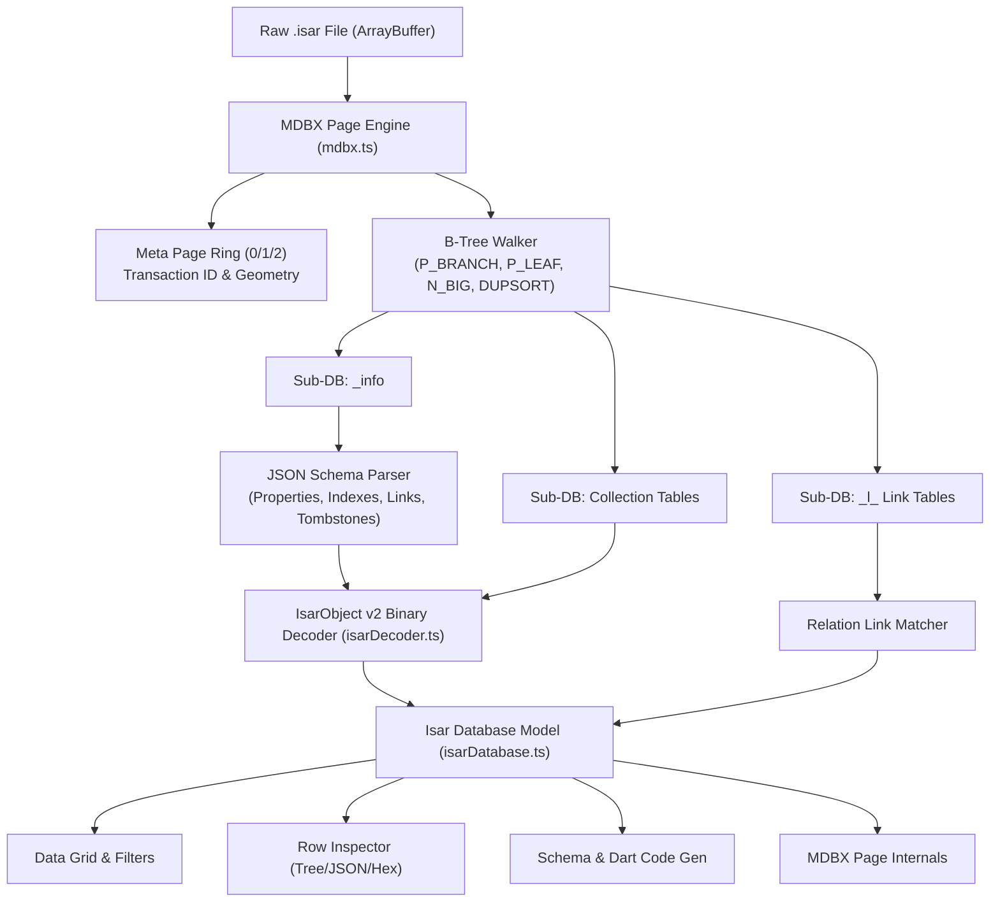

<div align="center">

# ⚡ Isar Viewer

**Modern, standalone, offline web viewer and inspector for Flutter [Isar Database](https://isar.dev) (`.isar`) files.**

[](LICENSE)
[](https://www.typescriptlang.org/)
[](https://react.dev/)
[](https://tailwindcss.com/)
[](https://vitest.dev/)
[](https://github.com/isar/isar)

<br />

<p align="center">
  <b>No Flutter runtime required. No Dart models required. No emulator needed.</b><br />
  Drag & drop any raw <code>.isar</code> file straight into your browser to inspect collections, resolve relational links, explore schemas, and export to JSON or CSV.
</p>

</div>

---

## 🎯 The Problem

In Flutter development, [Isar](https://isar.dev) is renowned for being an ultra-fast NoSQL database. Under the hood, Isar v3 uses **`libmdbx`** (an advanced LMDB fork) with an internal binary layout called **`IsarObject v2`**.

Because Isar enforces compile-time code generation (`*.g.dart`), its official inspector (`https://inspect.isar.dev`) **only works during an active `flutter run` debug session via WebSocket**. 

When you pull a `.isar` file from a physical device, production build, QA bug report, or tester backup, there has traditionally been **no offline GUI viewer** capable of opening and browsing it without building a custom Flutter debug harness.

**Isar Viewer solves this completely.** It implements a pure TypeScript parser for both **MDBX storage pages** and the **IsarObject binary specification**, running 100% locally in your browser.

---

## ✨ Features

- **📂 Instant Drag & Drop**: Drop any `.isar` file to view it immediately, or use the built-in **"Load Sample Database"** for instant testing.
- **🔍 Auto Schema Discovery**: Automatically reads the internal `_info` sub-database to reconstruct all collections, properties, embedded objects, indexes, and schema versions.
- **⚡ Relational Link Resolver (`IsarLink`)**: Automatically resolves MDBX duplicate-sort link tables (`_l_<Collection>_<Link>`) so you can see linked records and click to navigate between them.
- **📊 Rich Data Grid**:
  - Global search & multi-operator column filtering (`=`, `!=`, `>`, `<`, `>=`, `contains`, `is null`, `is not null`).
  - Column sorting with toggleable ascending/descending states.
  - Column visibility manager (show/hide fields).
  - Microsecond timestamp detection with one-click human-readable DateTime formatting.
- **🔎 Deep Row Inspector Drawer**:
  - **Interactive Tree View**: Expand nested embedded objects, lists, and primitives.
  - **Raw JSON View**: Copy individual records or export whole collections.
  - **Hex Dump Inspector**: Inspect exact byte layout and static size offsets.
- **📐 Schema & ER Visualizer**:
  - Interactive collection and embedded cards with relation highlighting on hover.
  - Built-in **Dart Model Generator**: Reverse-engineers production-ready `@collection class` Dart code directly from your database.
- **🔬 MDBX Storage Internals**:
  - Inspect MVCC meta pages (pages 0, 1, 2) and verify transaction IDs.
  - B-tree page statistics (item count, tree height, branch/leaf/overflow pages).
- **🔄 Live Auto-Watch**:
  - When opened via File System Access API, toggle "Watch" mode to auto-refresh the grid every 2 seconds as your Flutter app writes changes to disk.
- **🔒 100% Client-Side & Private**:
  - Zero server uploads. Your database never leaves your machine.
- **🌓 Dark & Light Mode**:
  - Sleek modern developer UI styled with Tailwind CSS v4 and JetBrains Mono.

---

## 🏗️ Architecture



---

## 📦 Supported Isar Data Types

| Isar Type | Binary Representation | Viewer Support |
| :--- | :--- | :---: |
| `Id` | 8-byte XORed signed integer (`key ^ 0x8000000000000000n`) | ✅ Full (incl. negative IDs) |
| `Bool` | 1-byte (`0x00` null, `0x01` false, `0x02` true) | ✅ Full |
| `Byte` | 1-byte unsigned (`0..255`) | ✅ Full |
| `Int` | 4-byte little-endian 32-bit signed integer | ✅ Full |
| `Float` | 4-byte little-endian IEEE 754 float | ✅ Full |
| `Long` | 8-byte little-endian 64-bit signed integer | ✅ Full |
| `Double` | 8-byte little-endian IEEE 754 double | ✅ Full |
| `DateTime` | 8-byte microsecond timestamp (UTC/Local) | ✅ Full (with date toggle) |
| `String` | 3-byte offset pointer → 3-byte length + UTF-8 payload | ✅ Full |
| `Object` (Embedded) | 3-byte offset pointer → recursive IsarObject binary buffer | ✅ Full |
| `*List` (Primitives) | 3-byte offset pointer → 3-byte length + compact elements | ✅ Full |
| `StringList` / `ObjectList` | 3-byte offset pointer → length + size table + payloads | ✅ Full |
| `IsarLinks<T>` | MDBX `DUPSORT` sub-pages or `P_DUPFIX` sub-trees | ✅ Full (navigable) |

---

## 🚀 Quick Start

### Prerequisites
- Node.js 18+ (tested on Node 20 / 22 / 24)
- npm, pnpm, or bun

### Installation & Run

```bash
# Clone the repository
git clone https://github.com/algavania/isar-viewer.git
cd isar-viewer

# Install dependencies
npm install

# Start local development server
npm run dev
```

Visit **`http://localhost:5173/`** in your browser.

---

## 🧪 Testing

The repository includes comprehensive automated tests covering:
- Parsing multi-collection databases with embedded types and relational links
- Traversal of multi-level `P_BRANCH` B-trees and `N_BIG` overflow pages
- Signed and negative 64-bit Isar IDs
- Schema migration evolution and tombstone fields
- CSV and JSON serialization

Run the test suite with:

```bash
npm test
```

---

## 🛠️ Production Build

To create a static production bundle:

```bash
npm run build
```

The compiled output will be generated in `dist/`. You can serve it with any static web server (such as Vercel, Netlify, Cloudflare Pages, or `npx serve dist`).

---

## ⌨️ Keyboard Shortcuts

| Shortcut | Action |
| :--- | :--- |
| `Esc` | Close active Row Inspector drawer |
| `↓` / `↑` | Navigate to next / previous record in the table |
| `Enter` | Add column filter in filter dialog |

---

## 🛡️ Privacy & Security

Isar Viewer is designed with security and privacy as first-class guarantees:
- **No data ever leaves your device**: Database files are decoded directly in memory via JavaScript `ArrayBuffer` and `DataView`.
- **Read-Only**: The parser never writes to or alters your `.isar` database file.

---

## 📄 License

MIT © [Alga](https://github.com/algavania)
