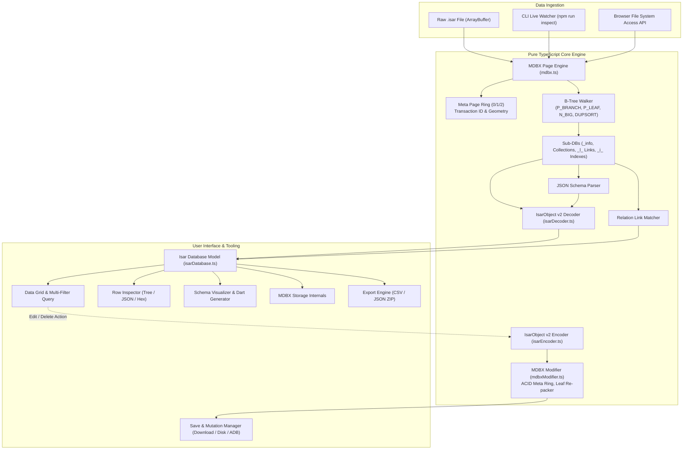

<div align="center">

# ⚡ Isar Viewer

**Modern, standalone, offline web viewer & editor for Flutter [Isar Database](https://isar.dev) (`.isar`) files.**

[](https://isar-viewer.algavania.com)

[](LICENSE)
[](https://www.typescriptlang.org/)
[](https://react.dev/)
[](https://tailwindcss.com/)
[](https://vitest.dev/)
[](https://github.com/isar/isar)

<br />

<p align="center">
  <b>No Flutter runtime required. No Dart models required. No emulator needed.</b><br />
  Drag & drop any raw <code>.isar</code> file straight into your browser to inspect collections, resolve relational links, edit records, explore schemas, and export to JSON or CSV.
</p>

<p align="center">
  👉 <b>Try it now in your browser: <a href="https://isar-viewer.algavania.com">https://isar-viewer.algavania.com</a></b>
</p>

</div>

---

## 🎯 The Problem

In Flutter development, [Isar](https://isar.dev) is renowned for being an ultra-fast NoSQL database. Under the hood, Isar v3 uses **`libmdbx`** (an advanced LMDB fork) with an internal binary layout called **`IsarObject v2`**.

Because Isar enforces compile-time code generation (`*.g.dart`), its official inspector (`https://inspect.isar.dev`) **only works during an active `flutter run` debug session via WebSocket**. 

When you pull a `.isar` file from a physical device, production build, QA bug report, or tester backup, there has traditionally been **no offline GUI viewer** capable of opening, browsing, or modifying it without building a custom Flutter debug harness.

**Isar Viewer solves this completely.** It implements a pure TypeScript engine for both **MDBX storage pages** and the **IsarObject binary specification**, running 100% locally in your browser with full read, query, edit, and export capabilities.

---

## ✨ Features

### 🔍 Viewing & Querying
- **📂 Instant Drag & Drop**: Drop any `.isar` file to view it immediately, or use the built-in **"Load Sample Database"** for instant exploration.
- **🔍 Auto Schema Discovery**: Automatically parses the internal `_info` sub-database to reconstruct all collections, properties, embedded objects, indexes, and schema versions.
- **⚡ Relational Link Resolver (`IsarLink` / `IsarLinks`)**: Resolves MDBX duplicate-sort link tables (`_l_<Collection>_<Link>`) so you can see linked records and navigate between them with a single click.
- **📊 High-Performance Data Grid**:
  - Global search across all columns with multi-line and regex support.
  - Multi-operator column filtering (`=`, `!=`, `>`, `<`, `>=`, `contains`, `is null`, `is not null`).
  - Column sorting with toggleable ascending/descending states.
  - Column visibility manager (show/hide specific fields).
  - Microsecond timestamp detection with one-click human-readable DateTime formatting.
  - Row memoization and smooth pagination (25, 50, 100, 250 rows).
- **🔎 Deep Row Inspector Drawer**:
  - **Interactive Tree View**: Expand nested embedded objects, lists, and primitives with copy shortcuts.
  - **Raw JSON View**: Formatted JSON representation with copy and download utilities.
  - **Hex Dump Inspector**: Low-level binary viewer with byte offsets, ASCII gutter, and static size breakdown.

### ✏️ Editing & Database Mutation
- **📝 In-Browser Record Editor**: Modify record fields directly inside the web UI with type-safe schema inputs (booleans, numbers, strings, date pickers, and JSON validation for embedded objects/lists).
- **🗑️ Record Deletion**: Delete records with automatic cascading cleanup across secondary indexes (`_i_...`) and relation tables (`_l_...`).
- **💾 MDBX Repacker & Binary Exporter**:
  - Pure TypeScript repacker preserves MDBX ACID invariants and B-tree leaf alignments.
  - Advances the MDBX 3-page MVCC meta ring with new transaction IDs (`txnid`).
  - Download the modified database as a 100% compliant `.isar` binary file.
  - Direct Save to disk when using the CLI dev server, with automatic `.bak` backup creation.
  - Built-in `adb push` command generator for pushing modified databases directly back to an Android device or emulator.

### 📦 Export Options
- **🗜️ Full Database ZIP Export**: Export all or selected collections into compressed `.zip` archives via `fflate`, featuring model checklists, selectable pretty/compact JSON formatting, relational link embedding, and `_schema.json` metadata manifest.
- **📄 Collection Export**: Export individual collections directly to **CSV** or **JSON**.

### 🛠️ Developer & Storage Tools
- **📐 Schema & ER Visualizer**:
  - Interactive collection and embedded cards with relation highlighting on hover.
  - Built-in **Dart Model Generator**: Reverse-engineers production-ready `@collection class` Dart source code directly from database metadata.
- **🔬 MDBX Storage Internals**:
  - Inspect MVCC meta pages (pages 0, 1, 2) and verify transaction IDs.
  - B-tree page statistics (item counts, tree heights, branch/leaf/overflow pages, sub-database flags).
- **⚡ Realtime Path Inspector & Live Watch**:
  - **Browser Native**: Automatically watches file changes via the browser's File System Access API when dropped.
  - **CLI Inspector**: Run `npm run inspect <path>` to launch with a Server-Sent Events (SSE) watcher that hot-reloads data the instant your Flutter app commits changes to disk.
- **💾 Session Persistence**:
  - Automatically caches the active database and UI state in browser IndexedDB (with safety thresholds for large files) so your work persists across page refreshes.
- **🌓 Dark & Light Mode**:
  - Beautiful dark and light themes persisted in `localStorage`, styled with Tailwind CSS v4 and JetBrains Mono.

---

## 🏗️ Architecture



---

## 📦 Supported Isar Data Types

| Isar Type | Binary Representation | Decoding | Encoding / Editing |
| :--- | :--- | :---: | :---: |
| `Id` | 8-byte XORed signed integer (`key ^ 0x8000000000000000n`) | ✅ Full | ✅ Full |
| `Bool` | 1-byte (`0x00` null, `0x01` false, `0x02` true) | ✅ Full | ✅ Full |
| `Byte` | 1-byte unsigned (`0..255`) | ✅ Full | ✅ Full |
| `Int` | 4-byte little-endian 32-bit signed integer | ✅ Full | ✅ Full |
| `Float` | 4-byte little-endian IEEE 754 float | ✅ Full | ✅ Full |
| `Long` | 8-byte little-endian 64-bit signed integer | ✅ Full | ✅ Full |
| `Double` | 8-byte little-endian IEEE 754 double | ✅ Full | ✅ Full |
| `DateTime` | 8-byte microsecond timestamp (UTC/Local) | ✅ Full | ✅ Full |
| `String` | 3-byte offset pointer → 3-byte length + UTF-8 payload | ✅ Full | ✅ Full |
| `Object` (Embedded) | 3-byte offset pointer → recursive IsarObject binary buffer | ✅ Full | ✅ Full |
| `*List` (Primitives) | 3-byte offset pointer → 3-byte length + compact elements | ✅ Full | ✅ Full |
| `StringList` / `ObjectList` | 3-byte offset pointer → length + size table + payloads | ✅ Full | ✅ Full |
| `IsarLinks<T>` | MDBX `DUPSORT` sub-pages or `P_DUPFIX` sub-trees | ✅ Full | ✅ Full (Cascade delete) |

---

## 🚀 Quick Start

### 🌐 Try Online (No Setup Needed)
Access the web viewer directly at **[isar-viewer.algavania.com](https://isar-viewer.algavania.com)**. Since processing is 100% client-side, your database files never leave your device.

---

### 💻 Local Development

#### Prerequisites
- Node.js 18+ (tested on Node 20 / 22 / 24)
- npm, pnpm, or bun

#### 1. Clone & Install

```bash
git clone https://github.com/algavania/isar-viewer.git
cd isar-viewer
npm install
```

#### 2. Run Web Development Server

```bash
npm run dev
```

Open **`http://localhost:5173/`** in your browser.

#### 3. Realtime Live Watch CLI

Inspect a local `.isar` file and auto-reload whenever your Flutter app commits data:

```bash
# Inspect a local database
npm run inspect ./sample.isar

# Inspect an iOS Simulator database
npm run inspect ~/Library/Containers/com.example.app/Data/Documents/default.isar

# Inspect an Android pulled database
npm run inspect ./default.isar
```

---

## 🧪 Testing

The repository includes comprehensive automated unit tests covering:
- **Binary Decoding**: Parsing multi-collection databases with embedded types, indexes, and relational links.
- **Binary Encoding**: Validating `IsarObject v2` dynamic offsets, UTF-8 strings, embedded layouts, and signed 64-bit IDs.
- **MDBX Repacking**: Mutating records, updating leaf pages, preserving secondary index tables, and advancing the MVCC meta page ring.
- **Query & Search Engine**: Complex filtering, multi-line search matching, and pagination.
- **Exporting**: JSON ZIP packaging with `fflate`, schema manifests, and CSV generation.
- **Session Persistence**: IndexedDB caching, buffer size thresholds, and view state recovery.
- **Server CLI Middleware**: File inspection endpoints, SSE live file watcher, and safe `.bak` backups.

Run the test suite with:

```bash
npm test
```

---

## 🛠️ Production Build

To create a static production bundle:

```bash
npm run build
```

The compiled output will be generated in `dist/`. You can serve it with any static web host (such as Cloudflare Pages, Vercel, Netlify, or `npx serve dist`).

---

## ⌨️ Keyboard Shortcuts

| Shortcut | Action |
| :--- | :--- |
| `Esc` | Close active Row Inspector drawer or modal |
| `↓` / `↑` | Navigate to next / previous record in the table |
| `Enter` | Add column filter in filter dialog |

---

## 🛡️ Privacy & Security

- **100% Client-Side & Local**: All database parsing, query filtering, and binary encoding happen directly in your browser's memory using `ArrayBuffer` and `DataView`. Zero database data or telemetry is sent to any external server.
- **Safe Editing & Backups**: Edits and deletions are staged in memory until explicitly saved. When using the CLI inspector to save directly to disk, an automatic `.bak` copy is created to prevent data loss.

---

## 📄 License

MIT © [Alga](https://github.com/algavania)
